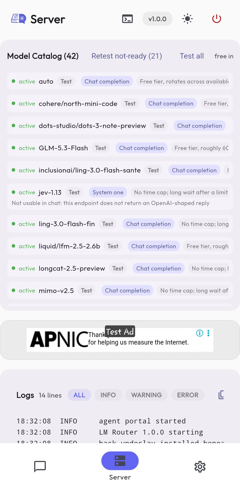
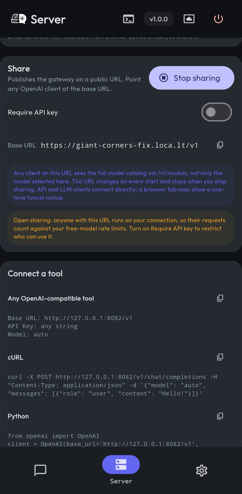
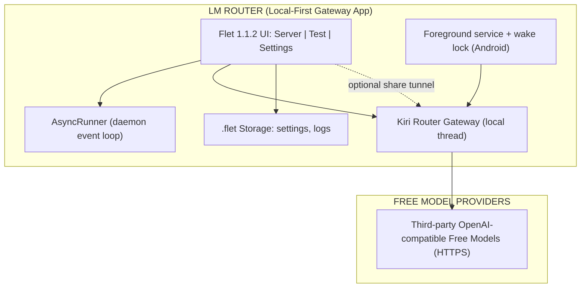

<p align="center">
  <picture>
    <source media="(prefers-color-scheme: dark)" srcset="src/assets/icon_white.svg">
    <source media="(prefers-color-scheme: light)" srcset="src/assets/icon.svg">
    
  </picture>
</p>

<p align="center">
  Your own OpenAI-compatible LLM gateway, running on your device — free models, one-tap model probes, shareable URL
</p>

<p align="center">
  <a href="https://github.com/Nwokike/lm-router/releases/latest"></a>
  <a href="https://github.com/Nwokike/lm-router/releases/latest"></a>
  <a href="https://github.com/Nwokike/lm-router/releases/latest"></a>
  
  
</p>

---

## Download

| Platform | Download | Notes |
| :---: | :---: | :--- |
| 🤖 **Android** | [](https://github.com/Nwokike/lm-router/releases/latest/download/lm-router-arm64-v8a.apk) | Most phones — see the split table below for other architectures |
| 🪟 **Windows** | [](https://github.com/Nwokike/lm-router/releases/latest/download/LMRouter.exe) | Automated standalone setup installer with desktop shortcut integration |
| 🐧 **Linux (Debian/Ubuntu)** | [](https://github.com/Nwokike/lm-router/releases/latest/download/LMRouter.deb) | Desktop package tailored for Ubuntu, Debian, Linux Mint & Pop!_OS |
| 🎩 **Linux (Fedora/RHEL)** | [](https://github.com/Nwokike/lm-router/releases/latest/download/LMRouter.rpm) | Desktop package tailored for Fedora, openSUSE, RHEL & CentOS |
| 📦 **Linux (Universal Portable)** | [](https://github.com/Nwokike/lm-router/releases/latest/download/LMRouter.tar.gz) | Universal standalone portable archive for Arch, Alpine, Steam Deck & all distros |

### Android Architecture Build Splits

| Variant | Download | Notes |
| :--- | :---: | :--- |
| 📱 **ARM64** (most phones) | [**lm-router-arm64-v8a.apk**](https://github.com/Nwokike/lm-router/releases/latest/download/lm-router-arm64-v8a.apk) | Modern 64-bit Android devices |
| 📱 **ARMv7** (older phones) | [**lm-router-armeabi-v7a.apk**](https://github.com/Nwokike/lm-router/releases/latest/download/lm-router-armeabi-v7a.apk) | Legacy 32-bit Android devices |
| 💻 **x86_64** (emulators) | [**lm-router-x86_64.apk**](https://github.com/Nwokike/lm-router/releases/latest/download/lm-router-x86_64.apk) | Chromebooks & Android emulators |

---

## Core Capabilities

| Capability | Description |
| :--- | :--- |
| **Local Gateway** | An OpenAI-compatible gateway runs on your own device at `127.0.0.1` — no account, no API key, no server in between. Point any OpenAI-compatible client (Cursor, Cline, Claude Code, any SDK) straight at it. |
| **The `auto` Model** | One model that rotates across healthy free models, so a dead or rate-limited model never ends a request. |
| **Technical Test Tab** | One-tap model probes through the gateway with the **raw REQUEST and RESPONSE JSON** shown in full, a collapsible reasoning block for thinking models, and a composer where Enter sends. |
| **Model Catalog** | Every model the gateway lists: status, latency, endpoint type, rate hints, per-model **Test** verdicts and retest sweeps for not-ready rows. |
| **Share** | Publish your gateway through a public tunnel with an optional API key, and hand out the full model catalog to other clients. |
| **Background Keep-Alive** | On Android a foreground service + wake lock keep the gateway alive while the app is minimized, with an ongoing notification whose **Exit** action fully closes the app. |
| **Cross-Platform** | The same app on Android, Windows and Linux — one codebase, no platform-specific builds. |

---

## Screenshots

### Server (homepage)

<table>
  <tr>
    <td width="50%"></td>
    <td width="50%"></td>
  </tr>
  <tr>
    <td align="center"><em>Model catalog with per-row test actions, rate hints, retest sweeps and the activity log.</em></td>
    <td align="center"><em>Share the gateway on a public URL any OpenAI client can use, with an optional key.</em></td>
  </tr>
</table>

---

## Features

- **Server (homepage)** — gateway status, start/stop, port and autostart, live logs with level filters, refresh model catalog, and the full catalog with per-model rate limits and endpoint types.
- **Test tab** — pick a model, send a prompt, get the parsed answer plus the exact request body and raw response JSON, with latency and token usage.
- **Share** — optional key-protected public URL with copy-paste connection snippets for any OpenAI-compatible tool (base URL, cURL, Python).
- **Background keep-alive (Android)** — sticky foreground notification + wake lock; the gateway survives minimizing, and the notification's Exit action closes the app completely.
- **Settings** — theme, gateway port and autostart, share key, update checks, About.
- **Onboarding** — terms gate and consent flow before first use.
- **Updates** — silent version check with release notes, plus a manual check from Settings.

---

## Architecture

| Layer | Technology | Purpose |
| :--- | :--- | :--- |
| **Frontend** | Flet 1.1.2 on Python 3.14 | Cross-platform UI — components, contexts, observable state, Markdown, services |
| **Async Core** | `AsyncRunner` (daemon event loop) | Runs httpx coroutines off the Flet loop; the shared HTTP client is bound to it |
| **Gateway** | router.kiri.ng fetched at startup | Local OpenAI-compatible endpoint with model discovery, health and rate hints |
| **Sharing** | Stdlib auth proxy + localtunnel protocol | Optional key-protected exposure of the local gateway to another OpenAI client |
| **Keep-Alive** | flet-notifications foreground service + `ft.Wakelock` | Android process survives minimizing while the gateway runs; notification Exit closes the app |
| **Settings** | Pure stdlib (JSON) | Typed settings with validation; corrupt files degrade to defaults instead of crashing |

### Visual Flow



---

## Development

```
uv sync                                   # install venv (dev group included)
uv run ruff check src tests               # lint (same paths CI lints)
uv run ruff format --check src tests      # format gate (same as CI)
uv run pytest -q                          # test suite
uv run flet run -v                        # run desktop app
uv run flet clean                         # delete build/ (Flutter shell + staged python)
uv run flet build apk --split-per-abi -v  # Android (matches CI)
```

## Privacy & Security

1. **On your device**: the gateway runs locally, binds only to `127.0.0.1`, and settings stay on this machine.
2. **No account**: no registration, no login, and no user API key is required for the built-in gateway.
3. **Requests go to third parties**: model requests exit from your IP to free providers that may log them and use them for training — we have no control over that.
4. **Share keys stay local**: an optional share API key is stored on this device only and never logged.
5. **Ad-supported on mobile**: mobile builds show Google AdMob ads, with consent managed through Google UMP.

## Legal Disclaimer

Free models are provided by third parties under their own terms and rate limits.
Your requests are sent to those third parties: they may log them and use them for
training. Model availability changes without notice. Ads are served by
Google AdMob on mobile builds only.

## Open Source Licenses

- [Flet](https://github.com/flet-dev/flet), `flet-ads` and `flet-notifications` (Apache-2.0)
- [Kiri Router](https://router.kiri.ng) — the local gateway this app runs
